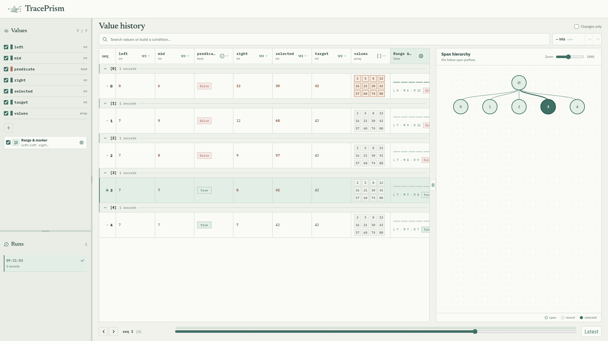

# TracePrism C++ SDK

C++23 の値を [TracePrism](https://github.com/manabeai/trace-prism) で可視化するヘッダーライブラリです。`nlohmann/json` 3.11 以降が必要です。

```bash
cmake -S . -B build -DCMAKE_BUILD_TYPE=Debug
cmake --build build
./build/binary_search
```

[`examples/binary_search.cpp`](examples/binary_search.cpp) は `#ifdef DEBUG` 内で SDK を読み込みます。Release ビルドでは `record(...)` が無効になり、記録処理は実行されません。

```cpp
#ifdef DEBUG
#include "traceprism.hpp"
#else
#define record(...) ((void)0)
#endif

record(step, values, left, right);
record({step, phase}, values, left, right); // 複数要素の ID
```

値は snapshot／patch 形式の `viz.trace/v2` に保存され、TracePrism の Runs に表示されます。構造体は `nlohmann::json` の `to_json` を定義すれば記録できます。保存先は `TRACEPRISM_RUN_DIR`、単一ファイルの保存先は `VIZ_TRACE_PATH` で指定できます。



